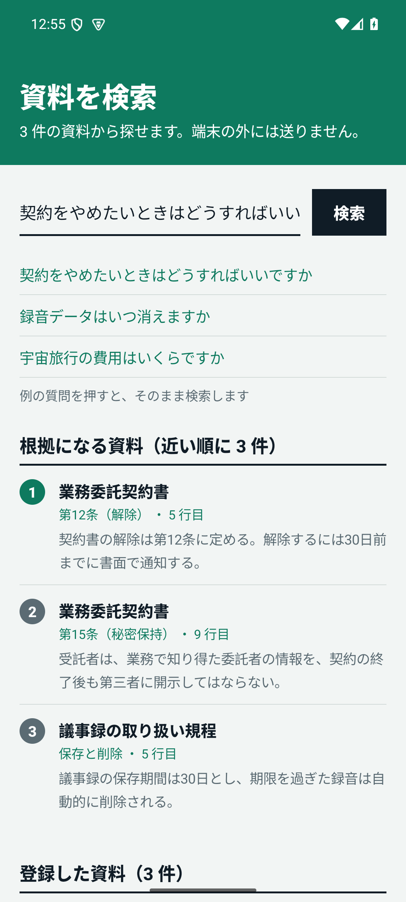
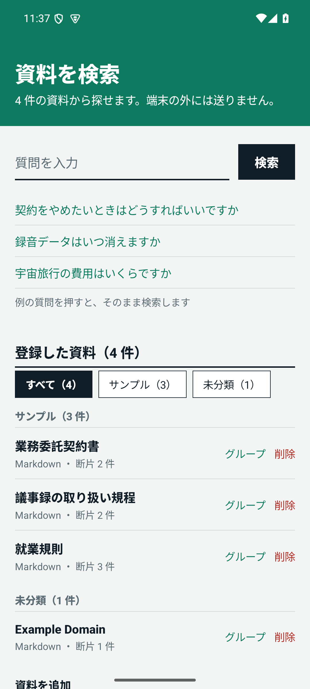
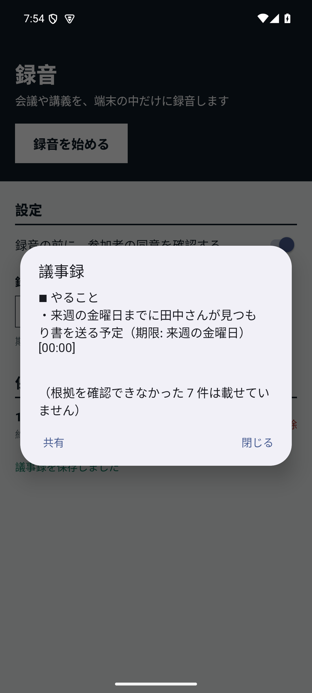
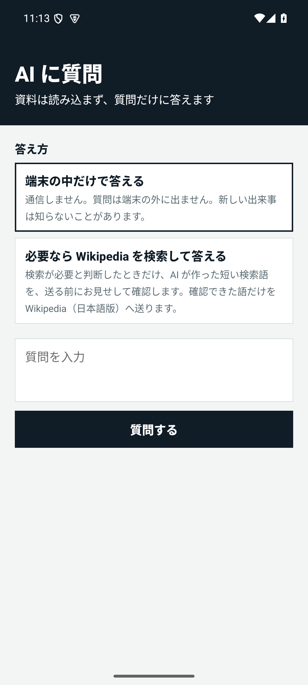
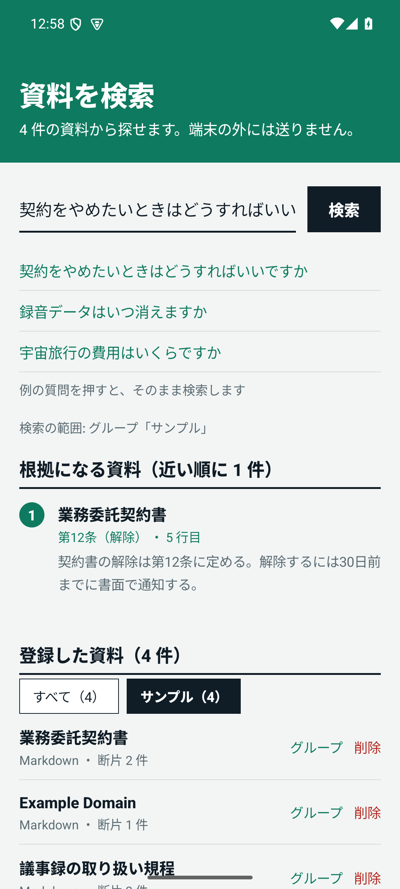
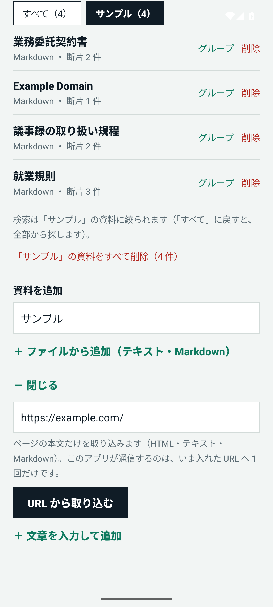
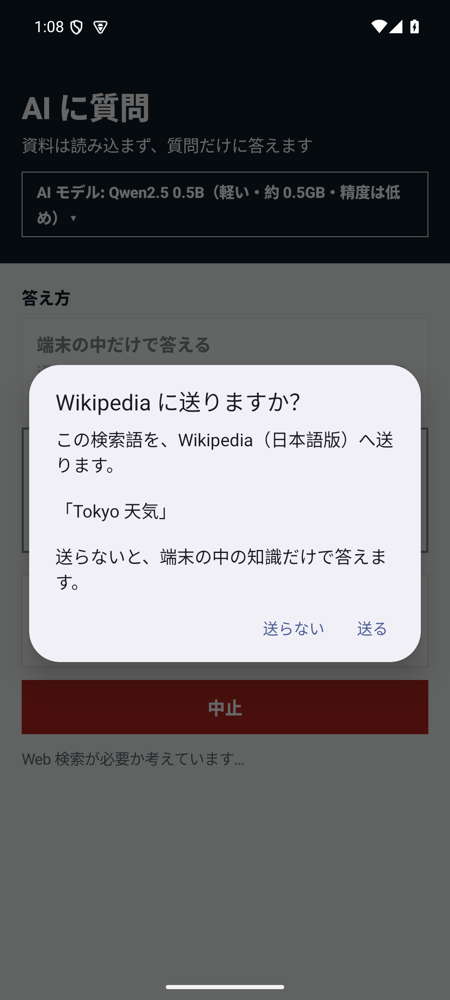
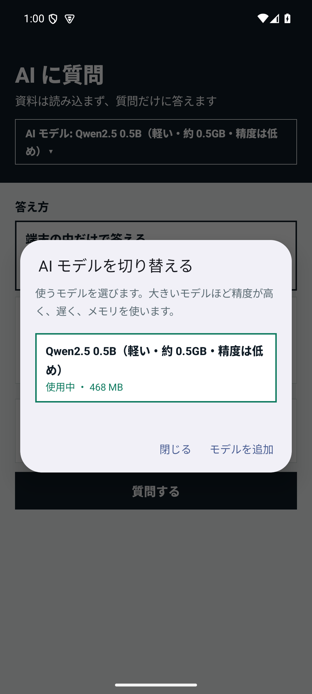

# LocalMind — A private AI assistant that runs entirely on your device

[日本語](INTRO.ja.md)

**Source code**: [GitHub (taotaro1104-commits/localmind)](https://github.com/taotaro1104-commits/localmind) / **Download**: [Google Drive (Android APK)](https://drive.google.com/drive/folders/1hfZGFiTYGIdArpSbNyXrt-hWH11323Wv?usp=drive_link)

LocalMind is an AI assistant that runs only on an Android device. It turns meeting recordings into minutes,
searches your own documents and answers your questions with AI, **without sending your recordings or documents
off the device**.

> **Current status**: The Rust core and the Android app that uses it (`android-sample/`, v0.1, a prototype) work
> today. Verification has been done on an emulator (x86_64, API 35) only; speed and behavior on a real arm64
> device are still to be checked. Small AI models are fast but rough, and AI answers can be wrong. See
> [TASKS.md](TASKS.md) for progress.

<p>
  
  
  
  
</p>

*From the left: document search with sources, document groups, minutes with the time of the cited speech,
and asking the AI (emulator, Japanese screens).*

<p>
  
  
  
  
</p>

*From the left: a search limited to a group, adding a document from a URL, the confirmation before search words are sent, and switching the AI model (emulator, Japanese screens).*

## Get it

- **APK (Android)**: shared on [Google Drive](https://drive.google.com/drive/folders/1hfZGFiTYGIdArpSbNyXrt-hWH11323Wv?usp=drive_link) (`LocalMind-0.1.apk`, about 700 MB). It is signed with a key we
  generated ourselves, so your device will ask you to allow apps from unknown sources. Downloading over Wi-Fi is recommended.
  The AI models are not inside the APK; you download one separately the first time you use it.
  SHA-256 (v0.1): `078f7c82afc78e46455492537aa14018be75717d00c0895ee2696f5b1c668224`
- **Source code**: [GitHub](https://github.com/taotaro1104-commits/localmind). The build steps are in [android-sample/README.md](../android-sample/README.md) (written in Japanese).

## What it does

| Feature | What it does |
|---|---|
| Recording and transcription | Records meetings and lectures on the device only. You can confirm everyone's consent before recording, and a notification is always shown while recording. Transcription runs on the device (whisper.cpp). |
| Minutes | Writes a summary, decisions, action items and open issues from the transcript, using a local LLM (llama.cpp). Each item carries the time of the speech it is based on, and items that cannot cite a real utterance are left out. |
| Document search | Imports text and Markdown documents by typing, from a file, from the share sheet, or from a **URL**. It combines full-text search (BM25) with semantic search and shows where the answer is, with the document, heading and line number. When there is no answer it says "not found". Documents can be put into **groups**, and both the list and the search range can be switched between them. |
| Asking the AI | Ask questions without loading any document. By default it answers on the device alone. Only when you choose, it sends short search words made by the AI to the Japanese Wikipedia, after you confirm them, and answers from the results (with sources). |
| Screen language | The app's screens are in Japanese and English, following the device language (or the per-app language on Android 13 and later). Transcription and minutes are tuned for Japanese for now. |
| Switching AI models | Pick Qwen2.5 0.5B, 1.5B or 3B, or give a URL for another model (GGUF) to download. Downloaded models stay on the device, and you can switch between them or delete them at any time. |

## Principles

- **Keep your data on the device**: Recordings, transcripts and documents are not sent out. The network is used
  only to download an AI model, for a Wikipedia search you chose, and for "Add from URL" on a document, each
  with your action and confirmation.
- **No answers without evidence**: When your documents do not contain the answer, it says "not found". Minutes
  drop items that cannot cite a real utterance.
- **Search that is strong in Japanese**: It handles both exact terms, such as model numbers, names and statute
  article numbers, and questions phrased in different words.
- **Recording requires consent**: A recording without confirmed consent cannot be saved, and recordings past
  their retention period are deleted automatically.
- **Kind to battery and heat**: Heavy work runs one job at a time, while charging and when the device is cool
  (the scheduler).
- **Large models are downloaded with your consent**: The AI models (about 0.5 to 2.1 GB) are not bundled; they
  are downloaded the first time you need one. The embedding model for search (multilingual-e5-small, about
  470 MB) is bundled and runs offline.

## Safety measures

- On the Rust side the network uses rustls (TLS) only, and OpenSSL-based dependencies are banned. Model
  downloads and searches are made from Kotlin, and where they connect is fixed or checked: Wikipedia is fixed,
  models come from allowed hosts, and a URL document is fetched only from public addresses, with the address that
  was actually connected to checked as well.
- A model is not loaded unless it matches its pinned SHA-256. A model you specify by URL comes with a warning and
  needs your consent first.
- LLM output is not trusted. The output shape is constrained by a grammar, and the minutes' citations and the
  answer's source numbers are checked against what really exists. Transcripts, documents and search results are
  passed as delimited data that must not be obeyed as instructions.
- Inputs from outside (paths, sizes, strings, HTML) are validated at the boundary and capped.
- CI runs formatting, static analysis, tests, and dependency vulnerability and license checks. GitHub Actions are
  pinned by commit SHA.

## Structure

A Rust core with a UniFFI layer that Kotlin can call.

| Crate | Role |
|---|---|
| `lm-scheduler` | Job priority and run conditions |
| `lm-router` | Choosing the processing route |
| `lm-search` | Search (normalization, BM25, vectors, fusion, grounding) |
| `lm-workspace` | Storing, splitting and searching documents, citations with positions, groups, and extracting text from HTML |
| `lm-ingest` | Recording intake, storage, retention, minutes (with citation checks) |
| `lm-whisper` | Transcription (whisper.cpp) |
| `lm-llm` | Minutes extraction and question answering with a local LLM (llama.cpp) |
| `lm-ffi` | Kotlin bindings for search, documents, recording and transcription |
| `lm-llm-ffi` | Kotlin bindings for minutes and question answering. whisper.cpp and llama.cpp both bundle ggml and cannot live in one library, so this is a separate one |

`android-sample/` is the Android app that uses them. On an emulator (x86_64, API 35) we have confirmed the whole
flow from recording to minutes, document search and import, and asking the AI. Verification on a real arm64
device has not been done yet.

## Not done yet

- Checking real devices and their speed, and improving the accuracy of small models
- Minutes for long meetings (the transcript used for minutes is limited to 5,000 characters)
- Importing PDFs, and reading text from images (OCR)
- Using the on-device AI (Gemini Nano), and distribution on Google Play (the app is about 700 MB, over the
  size limit)

## Try it

```
cargo test --workspace --all-features
```

For building and using the Android app, see [android-sample/README.md](../android-sample/README.md). The design
is in [ARCHITECTURE.md](ARCHITECTURE.md) and [ROADMAP.md](ROADMAP.md) (written in Japanese).
