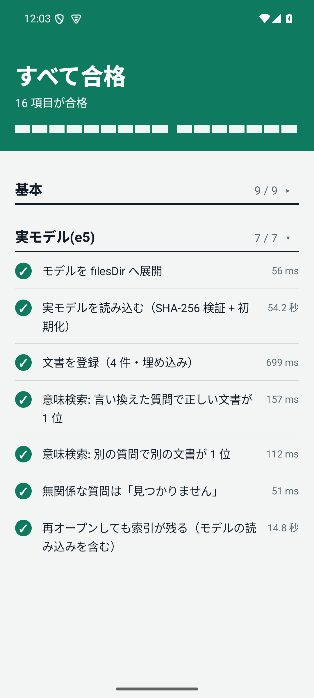

# LocalMind — A private AI assistant that runs entirely on your device

[日本語](INTRO.ja.md)

LocalMind is an AI assistant that runs only on an Android device. It aims to search your documents and
write meeting minutes **without sending your data off the device**.

> **Current status**: The Rust core and a minimal Android sample work today. The app's screens, the LLM
> connection, and the recording UI and notifications are not built yet. See [TASKS.md](TASKS.md) for progress.



*Self-test on an emulator (x86_64, API 35): 9 basic checks and 7 real-model (e5) checks pass.*


*Searching your documents. Each result cites the document, heading path and line number (emulator).*

## Goals

- **Start with zero downloads**: It prefers AI features already on the device and falls back to a small
  model on devices that lack them. Every feature must work on every supported device.
- **Search that is strong in Japanese**: It handles both exact terms, such as model numbers, names and
  statute article numbers, and questions phrased in different words.
- **No answers without evidence**: When your documents do not contain the answer, it says so ("not found
  in your documents") instead of making something up.
- **Recording requires consent**: A recording without confirmed consent cannot be saved, and recordings
  past their retention period are deleted automatically.
- **Kind to battery and heat**: Heavy work runs one job at a time, while charging and when the device is cool.

## Core features

| Feature | What it does |
|---|---|
| Hybrid search | Combines Japanese morphological full-text search (BM25) with semantic (vector) search and ranks the results. It absorbs spelling variants such as full-width and half-width characters, old kanji forms and katakana long vowels. |
| Grounding check | If the score is below a threshold, it returns "not found" and lets the user choose whether to answer from general knowledge. |
| Bundled embedding model | Ships multilingual-e5-small (about 470 MB) inside the app and runs offline. Each file is verified by SHA-256 when loaded. |
| Minutes foundation | Saves recordings in 30-second chunks that survive a crash, removes silence, and replaces draft transcripts with higher-quality ones. |
| Routing | Picks a target per task (on-device AI, small model, PC, speech recognition) and falls back to the small model when needed. |
| Scheduler | Prioritizes recording over chat, indexing and reprocessing, and prevents heavy jobs from running at the same time. |

## Safety measures

- Network access uses rustls (TLS) only. OpenSSL-based dependencies are banned.
- The bundled model is not loaded unless it matches pinned SHA-256 hashes. Corrupted files are re-extracted automatically.
- Inputs from outside (paths, sizes, strings) are validated at the boundary and capped.
- CI runs formatting, static analysis, tests, and dependency vulnerability and license checks. GitHub Actions are pinned by commit SHA.

## Structure

A Rust core with a UniFFI layer that Kotlin can call.

| Crate | Role |
|---|---|
| `lm-scheduler` | Job priority and run conditions |
| `lm-router` | Choosing the processing route |
| `lm-search` | Search (normalization, BM25, vectors, fusion, grounding) |
| `lm-ingest` | Recording intake, storage, retention, minutes |
| `lm-ffi` | Kotlin bindings (UniFFI) |

`android-sample/` is a minimal app that tries Japanese search with the real model. It has been verified on
an emulator (x86_64, API 35). Verification on a real arm64 device has not been done yet.

## Try it

```
cargo test --workspace --all-features
```

For the Android sample, see [android-sample/README.md](../android-sample/README.md). The design is in
[ARCHITECTURE.md](ARCHITECTURE.md) and [ROADMAP.md](ROADMAP.md) (written in Japanese).
