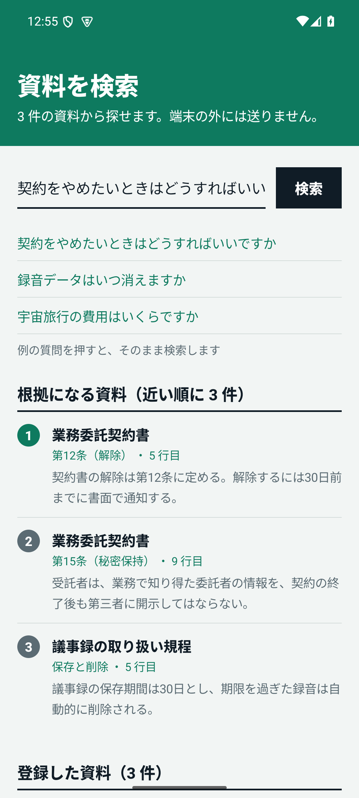
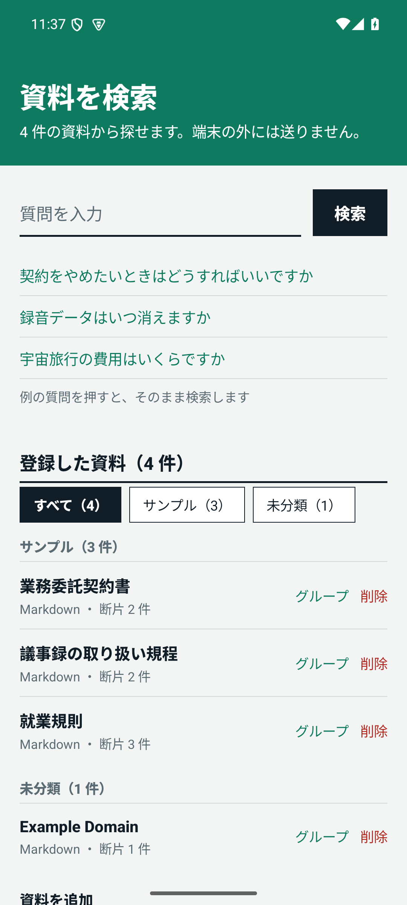
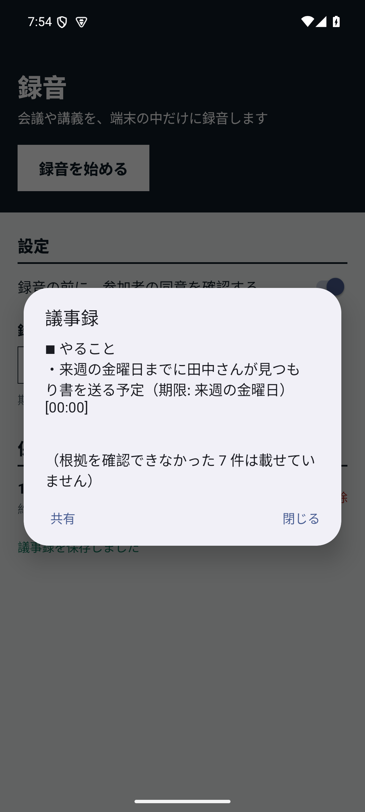
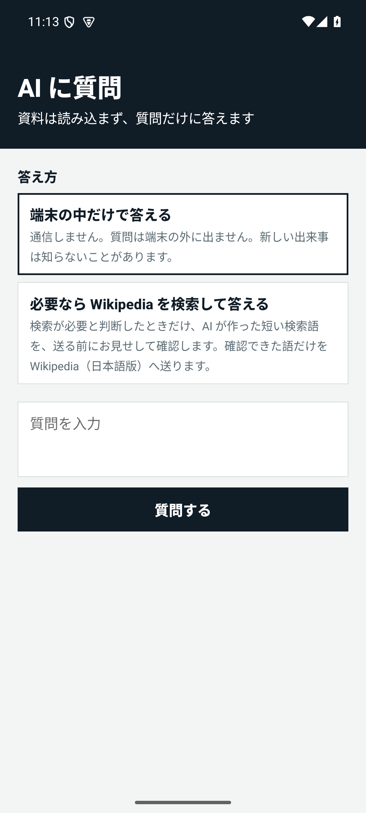

# LocalMind — 端末の中で完結する、プライベートな AI アシスタント

[English](INTRO.en.md)

LocalMind は、Android 端末の中だけで動く AI アシスタントです。会議の録音から議事録をつくり、手元の資料を探し、
AI に質問することを、**録音も資料も端末の外へ出さずに**行います。

> **現在の状態**: コア（Rust）と、それを使う Android アプリ（`android-sample/`、v0.1・試作版）が動いています。
> 確認はエミュレータ（x86_64、API 35）までで、実機（arm64）での速さと動作はこれからです。
> 小さな AI モデルは速い代わりに精度が粗く、AI の答えは誤りを含むことがあります。進捗は [TASKS.md](TASKS.md) を参照してください。

<p>
  
  
  
  
</p>

*左から、資料の検索（根拠つき）、資料のグループ分け、議事録（根拠の発話の時刻つき）、AI への質問（エミュレータ）。*

## できること

| 機能 | 内容 |
|---|---|
| 録音と文字起こし | 会議や講義を端末の中だけに録音します。録音前に参加者の同意を確認でき、録音中は通知を常に出します。文字起こしは端末の中（whisper.cpp）で行います。 |
| 議事録 | 文字起こしから、要約・決定事項・やること・未解決の論点を作ります（ローカルの LLM、llama.cpp）。各項目に、根拠にした発話の時刻が付き、実在する発話を根拠にできない項目は載せません。 |
| 資料の検索 | テキスト・Markdown の資料を、入力・ファイル・共有・**URL** から取り込みます。全文検索（BM25）と意味検索を合わせ、答えのある箇所を、文書・見出し・行番号つきで出します。答えが無いときは「見つかりません」と返します。資料には**グループ**を付けて、一覧と検索の範囲を切り替えられます。 |
| AI への質問 | 資料を読み込まずに質問できます。既定は端末の中だけで答えます。選んだときだけ、AI が作った短い検索語を、確認のうえで日本語版 Wikipedia へ送り、その結果（出典つき）をもとに答えます。 |
| AI モデルの切り替え | Qwen2.5 の 0.5B・1.5B・3B から選ぶか、URL で別のモデル（GGUF）を指定して取得します。取得したモデルは残り、いつでも切り替えたり削除したりできます。 |

## 方針

- **データを端末の外へ出さない**: 録音・文字起こし・資料は送りません。通信するのは、AI モデルのダウンロード、
  利用者が選んだ Wikipedia 検索、資料の「URL から追加」のときだけです（どれも、利用者の操作と確認のうえ）。
- **根拠のない答えをしない**: 資料に答えが無いときは「見つかりません」と返します。議事録は、根拠の発話を引用できない項目を落とします。
- **日本語に強い検索**: 型番、人名、条文番号のような「正確に一致してほしい語」と、言い換えた質問の両方に答えます。
- **録音は同意が前提**: 同意が確認されていない録音は保存できません。保存期間を過ぎた録音は自動で削除されます。
- **電池と発熱に配慮**: 重い処理は同時に 1 つだけ、充電中・低温のときに動かします（スケジューラ）。
- **大きなモデルは、同意のうえで取得**: AI モデル（約 0.5〜2.1GB）はアプリに同梱せず、初めて使うときにダウンロードします。
  検索用の埋め込みモデル（multilingual-e5-small、約 470MB）は同梱し、オフラインで動かします。

## 安全面の取り組み

- Rust 側のネットワークは rustls（TLS）のみで、OpenSSL 系の依存は禁止しています。モデルの取得や検索の通信は Kotlin 側にあり、
  接続先は固定または検査します（Wikipedia は固定、モデルは許可したホスト、URL の資料は公開アドレスだけで、接続した相手も検査します）。
- モデルは、固定した SHA-256 と一致しなければ読み込みません。URL で指定したモデルは、取り込み前に警告と同意があります。
- LLM の出力は信用しません。文法で形を縛り、議事録の根拠の実在、質問応答の出典番号を検証します。
  文字起こし・資料・検索結果は命令に従わない「データ」として区切って渡します。
- 外から入る値（パス、サイズ、文字列、HTML）は境界で検証し、上限を設けています。
- CI で、書式、静的解析、テスト、依存の脆弱性とライセンスの検査を行い、GitHub Actions はコミット SHA で固定しています。

## 構成

Rust のコアに、UniFFI で Kotlin から呼べる層をかぶせています。

| クレート | 役割 |
|---|---|
| `lm-scheduler` | ジョブの優先度と実行条件 |
| `lm-router` | 処理経路の決定 |
| `lm-search` | 検索（正規化、BM25、ベクトル、統合、根拠判定） |
| `lm-workspace` | 資料の保存・分割・検索、位置つきの引用、グループ、HTML からの本文の取り出し |
| `lm-ingest` | 録音の取り込み、保存、保持期限、議事録（根拠の検証） |
| `lm-whisper` | 文字起こし（whisper.cpp） |
| `lm-llm` | ローカル LLM（llama.cpp）による議事録の抽出と、質問応答 |
| `lm-ffi` | Kotlin へのバインディング（検索・資料・録音・文字起こし） |
| `lm-llm-ffi` | Kotlin へのバインディング（議事録・質問応答）。whisper.cpp と llama.cpp は ggml を同梱していて同居できないため、別のライブラリにしています |

`android-sample/` は、これらを使う Android アプリです。エミュレータ（x86_64、API 35）で、録音から議事録まで、
資料の検索と取り込み、AI への質問の通しを確認しています。実機（arm64）での検証はこれからです。

## まだできないこと

- 実機での動作と速さの確認、小さなモデルの精度の向上
- 長い会議の議事録（議事録に使える文字起こしは 5,000 文字まで）
- PDF の取り込みと、画像からの文字読み取り（OCR）
- 端末の AI（Gemini Nano）の利用、Google Play での配布（アプリが約 700MB あり、サイズの上限を超えます）

## 動かしてみる

```
cargo test --workspace --all-features
```

Android アプリのビルドと使い方は [android-sample/README.md](../android-sample/README.md)、設計は
[ARCHITECTURE.md](ARCHITECTURE.md) と [ROADMAP.md](ROADMAP.md) にあります。
